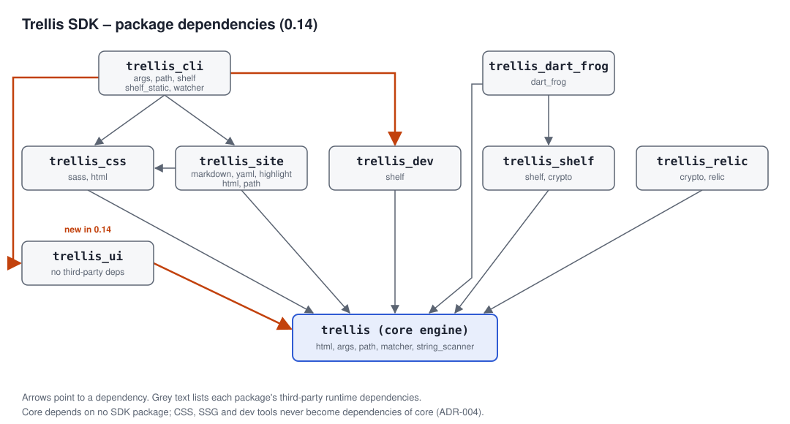

# Trellis SDK — System Architecture

Canonical reference for understanding the Trellis SDK architecture: how the packages compose, what each package is responsible for, the dependency graph, and how a request flows through the system.

**Current through**: 0.15 docs Command palette and prepared search index on 2026-11-21.
Dev reload, scaffold CSP and UI previews updated for 0.14 on 2026-11-17. `trellis dev` site
preview, including theme watch recovery, output exclusions and startup cleanup, is current through 0.14 on
2026-11-18. The named site source
pipeline and CLI registry were verified for 0.14 on 2026-11-18. Source-scoped URL trust is current through
0.15 on 2026-11-20, as are grouped header navigation and the Lattice and Meadow suite adoption. UI asset
embedding is current through 0.15 on 2026-11-21. The wider scope is the v0.11.0 SDK + the
2026-09-03 docs-site SSG positioning change (first-class Sites documentation,
Lattice `site_demo` home block, and the `examples/docs_site/` proof) + the 2026-09-04 HTMX 4 adapter
compatibility (ADR-011 amendment) + the 0.12 SASS module bridge (ADR-013): theme stylesheets compile through
`@use … with()` instead of `@import`, with per-mode colour params + 0.13 bridge hardening: one shared
`compileThemeEntry` that configures each entry with the params Sass accepts and reports the ones it drops,
build-time warnings for palette-default drift and for a site override Sass cannot apply (`trellis_site` now
depends on `trellis_css`), and the redrawn package graph. The `trellis_ui` package map, pipeline and qualification sections
are current through the 0.14 sync inventory and shared browser qualification decision (2026-11-18).
Relic is current through its 0.15 development reload (2026-11-20).
The content model's bundle rule and the `pathPrefix` coverage of feed and taxonomy URLs are current through 0.14.
Embedded UI placement, Popover, Tooltip, Sheet, Accordion and Navigation menu are current through 0.15 (2026-11-20).
Other sections retain the verification scope above.
The Dart Frog CSRF bridge note is current through 0.14 (it runs on Dart Frog's own request, so a handler can read the body after a form-field token).
The app-owned Tier 2 date recipe is current through 0.15 (2026-11-20).

---

## System Overview

Trellis is a Dart toolkit for building server-rendered web applications and static sites. It consists of independently publishable packages in a monorepo, centered around a core template engine.



*Hand-written SVG; update it from the pubspecs when a package dependency changes.*

---

## Package Responsibilities

### Current (0.13, lockstep)

| Package | Responsibility | Dependencies | Status |
|---|---|---|---|
| **`trellis`** | HTML template engine: parsing, expression evaluation (incl. utility objects), processor pipeline, fragment rendering, caching, validation, template inheritance, contextual escaping. Also includes testing utilities via `testing.dart` (test engine factory, CSS-selector matchers, snapshot golden file testing, fragment helpers). | `html`, `args`, `path`, `matcher`, `string_scanner` | v0.13.0 |
| **`trellis_shelf`** | Shelf middleware: engine injection, HTMX helpers, security defaults (CSRF, CSP), response builders | `trellis`, `shelf`, `crypto` | v0.13.0 |
| **`trellis_dart_frog`** | Dart Frog integration: `trellisProvider()` DI middleware, response helpers (`renderPage`, `renderFragment`, `renderOobFragments`), HTMX detection, CSRF/security middleware bridged from `trellis_shelf` | `trellis`, `trellis_shelf`, `dart_frog` | v0.13.0 |
| **`trellis_relic`** | Serverpod Relic integration: response helpers with explicit engine passing, HTMX detection, `trellisSecurityHeaders()` and `trellisCsrf()` middleware, development browser reload | `trellis`, `relic`, `crypto` | v0.13.0 |
| **`trellis_ui`** | Embedded UI fragments, same-origin CSS/JS, neutral asset response and materialization. | `trellis` | v0.14.0 |
| **`trellis_dev`** | Dev tools: SSE browser hot reload, script injection middleware driven by a template loader or any change stream | `trellis`, `shelf` | v0.13.0 |
| **`trellis_css`** | CSS processing: Dart-native SASS/SCSS compilation via `package:sass`, `tl:scope` fragment-scoped CSS via CSS `@scope` | `trellis`, `sass`, `html` | v0.13.0 |
| **`trellis_site`** | Static site generation: content discovery, front matter, Markdown, taxonomies, pagination, sitemap, shortcodes, data cascade, Atom/RSS feeds, JSON search index and client, named build sources | `trellis`, `trellis_css`, `highlight`, `html`, `markdown`, `path`, `yaml` | v0.13.0 |
| **`trellis_cli`** | CLI tool: `trellis create` (htmx + blog + dart_frog + relic templates), `trellis build` (SSG, SASS and the embedded UI source), `trellis dev` (site preview: rebuild on change + browser reload), `trellis serve` (static output server), and `trellis theme` (`add`, `update`, `list`, `info`, `remove`) | `args`, `path`, `shelf`, `shelf_static`, `trellis_css`, `trellis_dev`, `trellis_site`, `trellis_ui`, `watcher` | v0.13.0 |
| ~~`trellis_test`~~ | *Merged into `trellis` core as `testing.dart` entry point (2026-03-18)* | — | — |

---

## Dependency Rules

From [ADR-004](../adrs/ADR-004-sdk-package-architecture.md):

1. **`trellis` (core) depends on no SDK package**, only small third-party libraries (`html`, `args`, `path`, `matcher`, `string_scanner`)
2. **Integration packages** (`trellis_shelf`, `trellis_dev`) may depend on `trellis`, never the reverse
3. **Tooling packages** (`trellis_css`, `trellis_cli`) may depend on runtime packages only for orchestration
4. **No cyclic package dependencies** — the dependency graph is a DAG
5. **Optional features stay optional** — CSS, SSG, and dev tools never become transitive deps of core

```bash
trellis_cli ──► trellis_site ──► trellis ──► package:html
     │               │
     │               ├──► trellis_css
     │               ├──► markdown
     │               └──► yaml
     ├──► trellis_css ──► trellis
     │         │
     │         ├──► sass
     │         └──► html
     ├──► trellis_ui ──► trellis
     ├──► trellis_dev ──► trellis
     ├──► watcher
     ├──► shelf
     └──► shelf_static
trellis_shelf ──► trellis ──► package:html
     │
     └──► shelf
trellis_dart_frog ──► trellis_shelf ──► trellis
     │
     └──► dart_frog
trellis_ui ──► trellis

trellis_relic ──► trellis ──► package:html
     │
     └──► relic
trellis_dev ──► trellis
     │
     └──► shelf
```

---

## Embedded UI delivery (0.14)

`trellis_ui` depends only on core at runtime. Its native controls, data views and four layout primitives are plain
fragments. Accordion uses native details and summary elements. A shared name limits a group to one open item.
When an HTMX swap inserts a replacement before removing its predecessor, distinct names preserve the intended
open item in both instances. CSS paints native state without suite JavaScript. Closed layout scales select hand CSS
classes. Final `zz-` hand files set target sizes, destructive contrast and forced-colour paint without altering the
pinned token values. `TrellisUiLoader` feeds embedded fragments into the app's engine via
`CompositeLoader`; `trellisUiRespond` exposes immutable status/headers/bytes for server glue on Shelf, Relic or Dart
Frog. Assets live under `/trellis-ui/`, use compile-time SHA-256 ETags and answer conditional GETs with 304.
`materializeTrellisUi` optionally writes the same bytes beside the binary and overwrites divergence.
An app with the suite dependency can invoke the same function through `dart run trellis_ui:materialize [dir]`.

Interactive fragments upgrade to light-DOM custom elements from the deferred classic script. One base owns
listener and popup cleanup for HTMX swaps, history and disconnect. Dialog, Alert Dialog and Sheet share
native modality and tab containment. Sheet upgrades a labelled section and keeps its content nodes through
its optional inline breakpoint. Link dismissal lets the destination take focus. Native popovers share
four-sided CSSOM placement with viewport flip, size caps and repositioning on scroll and resize.
Popover exposes trigger and content slots and restores focus on dismissal. Tooltip adds a description to a
slotted control and uses the shared hover helper to cancel pending transitions when pointer intent changes.
Its manual popover opens on keyboard focus and consumes Escape in the current modal scope. Navigation menu enhances native disclosures inside a navigation landmark. Each panel is an auto popover.
The suite tracks delayed pointer intent per disclosure and uses the native top layer to switch active panels.
The server compares final URLs to mark the current link. Combobox option responses replace only the results region.
Toast responses append to a pre-existing live region using an HTMX out-of-band swap.

The package's development pipeline vendors pinned shadcn TSX/style/tokens and licences, extracts `cn-*` hooks and
structural utilities, renames them to `trellis-*`, then compiles using a checksummed Tailwind standalone binary.
`tool/port.dart sync <tag>` snapshots the previous package at committed `HEAD`, fetches and builds a candidate
in scratch, then installs the single vendor pin, deterministic triage report and generated upstream inventory
together. The validator checks the active pin and compares the report's old and new identities and ordered
upstream rows with that inventory. Dispositions and reasons stay in the report.
`tool/port.dart check` regenerates and compares the four committed outputs. `tool/embed.dart` groups the hand CSS
by cascade layer, compresses it with Dart Sass in plain CSS mode and appends it to the generated stylesheet. It
compresses the separate HTMX indicator stylesheet the same way, bundles one classic script, and embeds assets
and fragments as base64 plus digests. Runtime and tests use these committed
outputs without invoking Tailwind or Node. Scoped resets replace page-wide preflight; all suite declarations are in
cascade layers so app overrides retain precedence. A discovered-page gallery renders the same embedded fragments
under strict CSP. The package graph SVG includes its single runtime dependency on the core engine.

`tool/ui_gate.dart` is a separate, package-independent development tool. YAML recipes select pages, states,
keyboard/HTMX steps and invariants; one `GateDriver` surface shares the checks across the existing raw-CDP
`BrowserProbe` and a raw WebDriver/BiDi Firefox adapter. Each run writes a deterministic per-component record,
keeps human-entered release-prep items, and compares per-OS state/style baselines containing both browsers.
The digest settles geometry and selected styles atomically without a CSP-blocked style element. Firefox hover
sampling replays the page state if another window takes focus before the snapshot. A failed visual setup can
also replay after a trusted visible blur in that attempt. Fixture proofs
run in the normal test tiers. The local release gate uses the same CLI for the gallery and for the admin and
scaffold launcher. App recipes, records and baselines live under `dev/ui-gate/apps/`. The CLI, release and reference
generator share the item verdict. Release and publication require both browser results. One passing measurement
can cover an explicitly unsupported emulation in the other browser, and the record preserves both outcomes.
Release checks match the optional component dispositions in ADR-012 to the exact failed items in the records.
They replay active manifests and preserve evidence for removed subjects. During a native modal state the gate
measures focus paint on controls inside the modal and still captures the visible background.

---

## Request Flow: Shelf + Trellis + HTMX

A typical request through a Trellis SDK application:

```
 Browser request
        │
        ▼
┌───────────────────────────────────────────────────┐
│                  Shelf Pipeline                   │
│                                                   │
│  logRequests()                                    │
│       │                                           │
│       ▼                                           │
│  trellisSecurityHeaders()  ← X-Frame, CSP, etc.   │
│       │                                           │
│       ▼                                           │
│  trellisEngine(engine)     ← inject into context  │
│       │                                           │
│       ▼                                           │
│  trellisCsrf(secret: ...)  ← token gen/validate   │
│       │                                           │
│       ▼                                           │
│  Router                                           │
│   ├─ GET /           → homeHandler                │
│   ├─ POST /todos     → createTodoHandler          │
│   └─ static files    → shelf_static               │
└───────────────────────────────────────────────────┘
        │
        ▼
┌───────────────────────────────────────────────────┐
│                  Route Handler                    │
│                                                   │
│  1. Get engine from request context               │
│  2. Check: isHtmxRequest(request)?                │
│     ├─ Yes → renderFragment(source, fragment, ctx)│
│     └─ No  → render(source, ctx)                  │
│  3. Return htmlResponse(html)                     │
└───────────────────────────────────────────────────┘
        │
        ▼
┌───────────────────────────────────────────────────┐
│               Trellis Engine                      │
│                                                   │
│  1. Parse HTML (or LRU cache hit)                 │
│  2. Clone DOM                                     │
│  3. Collect fragments                             │
│  4. Process DOM (priority-sorted processors)      │
│  5. Serialize to HTML string                      │
└───────────────────────────────────────────────────┘
        │
        ▼
  HTML response → Browser
  (full page or HTMX fragment)
```

### HTMX Fragment Pattern

When the browser makes an HTMX request (`HX-Request: true`), the handler returns only the targeted fragment instead of the full page. `renderFragment()` extracts and processes a single `tl:fragment` from the template. `renderFragments()` returns multiple fragments for OOB (out-of-band) swaps.

**Version policy and coupling boundary (ADR-011)** — the core engine is
hypermedia-agnostic: `hx-*` attributes pass through untouched and `renderFragments()`
is generic concatenation. All HTMX protocol coupling is five request-header reads
(`HX-Request`, `HX-Target`, `HX-Source`, `HX-Trigger`, `HX-Boosted`) confined to the three
optional adapter packages; the helpers accept both the HTMX 2 and the HTMX 4 header
formats, so a project can run either version against unchanged packages. Scaffolded projects pin the HTMX `latest` dist-tag (2.x) from a single
constant, `trellis_cli`'s `htmx_asset.dart`; the HTMX 4 migration is deferred pending an
explicit trigger. See [ADR-011](../adrs/ADR-011-htmx-version-policy.md).

### Dev-Mode Hot Reload

Current for 0.14 (2026-11-17): app scaffolds self-host the pinned HTMX build by default;
`--htmx-cdn` opts into the pinned CDN origin. All use `CspBuilder.strict()`, external CSRF
scripts where needed, and local indicator CSS. Plain `CspBuilder()` defaults remain unchanged.

In development, a same-origin reload script and parallel SSE connection keep the browser updated.
Shelf and Relic watch `static/`. Dart Frog watches `public/`:

```
Browser                          Server
   │                                │
   ├── GET /_dev/reload.js ────────►│  Same-origin JavaScript
   ├── EventSource(/_dev/reload) ──►│  SSE connection
   │                                │
   │   [template or CSS/JS edit]   │
   │                                ├── FileSystemLoader.changes fires
   │                                ├── Template cache cleared (templates only)
   │◄── SSE: event: reload ─────────│  Broadcast to all clients
   │                                │
   ├── location.reload() ──────────►│  Browser refreshes
   │                                │
```

Shelf's `devMiddleware` adapts its watcher to `liveReloadMiddleware(Stream<void>)`. Relic's
`trellisDevReload` mounts both GET routes and uses native response bodies. It inserts the client
before the closing body tag of buffered HTML. It coalesces file signals with a 50 ms quiet
period and closes the static watches and event streams when the template loader closes.
The default I/O transport pads each dev frame with an ignored SSE comment to reach the
socket before stream close. See [ADR-002](../adrs/ADR-002-browser-hot-reload-strategy.md#relic-adapter-015).

### Static site preview (`trellis dev`)

`trellis dev` reuses `trellis build`'s config loading and build (`loadSiteBuildConfig`, `buildSite`) with three
overrides: `pathPrefix` cleared, `baseUrl` set to `http://localhost:<port>`, and output to `build-<n>` under a temp
directory. `package:watcher` watches the site directory and, when its real path lies outside the site, the theme
directory (a relative `theme: ../..` or a theme project's symlinked example). While that directory is missing,
preview checks its path every 250 ms and reinstalls the recursive watch when it returns. Output exclusions
resolve existing symlinked ancestors even before the output exists. Events under the output directory or a
`.`-prefixed segment are ignored. Each valid config edit updates the theme watch and output exclusion before
rebuilding. Events debounce for 150 ms. One build runs at a time and edits
during it queue exactly one more. A successful build swaps the static handler to the new directory, deletes the
old one and emits on the stream behind `liveReloadMiddleware`; a failed build is deleted and the last good build
stays served. Ctrl-C or SIGTERM (SIGINT only on Windows) waits for an in-flight build and removes the temp
directory, including during startup. If the server has bound, shutdown first closes it and its open SSE connections.

---

### UI app scaffolds and local previews (0.14)

`trellis create --ui` adds the embedded suite loader, same-origin asset responses and a shared Components page to
the Shelf, Relic and Dart Frog scaffolds. The page and layout pair relative preview asset paths with served paths.
Template inheritance replaces the child page's head with the layout's head when rendered. Opening the child page
from disk uses its own head and the classic suite script.

Shelf and Dart Frog write the preview assets before starting their reload watchers. Relic uses the same preview
command on demand. The app's asset route serves embedded bytes before static-file lookup, so an edited preview
file cannot change the running app. The CLI emits this wiring as source text. The generated app owns the runtime
dependency and runs the materialization command from that dependency.

Dart Frog's generated cascade checks `public/` before its router. Its UI scaffold uses the custom entrypoint
to serve the suite prefix ahead of that cascade and apply strict headers to both paths. The entrypoint's
dev init hook materializes assets before the route middleware starts watching files.

The [admin example](../../examples/admin_app/) uses the Shelf integration. It shares the contacts query and list
fragment across full page loads and HTMX swaps, and a mutation returns the list plus out-of-band summary, dialog
host and toast updates. The AOT executable embeds the suite and reads the example's own templates and static
files alongside it.

### App-owned Tier 2 date recipe

The admin contact form posts three native date inputs through its existing create
and edit routes. The app vendors the unchanged Cally 0.9.2 module and MIT notice
from the pinned release archive. Its static handler serves the module and the
app's date adapter from the same origin, alongside HTMX and the embedded suite.

The adapter mounts a Cally calendar inside each Popover on initial load and after
HTMX swaps. The generated calendar reads the server-rendered inputs and writes
completed selections back to them. If the vendor module fails, the hidden
calendar controls stay hidden and the form still submits the native fields.
Before HTMX serializes history, the adapter removes listeners and restores the
pristine input and Popover markup. The same mounting path restores the live
roots left outside the swap and the roots inserted on a cache hit or miss. Both
start from the server-saved values.

---

## Template Inheritance (SDK Phase 1)

Template inheritance adds a **pre-pass** before the normal render pipeline:

```
Source HTML string
       │
       ▼
┌──────────────────┐
│ 1. Normalize     │
└──────────────────┘
       │
       ▼
┌──────────────────┐
│ 2. Parse + Cache │
└──────────────────┘
       │
       ▼
┌──────────────────┐
│ 3. Clone DOM     │
└──────────────────┘
       │
       ▼
┌──────────────────────────────────────┐
│ NEW: Inheritance Resolution Pre-Pass │
│                                      │
│  Detect tl:extends on root element   │
│  ├─ Load parent layout               │
│  ├─ Resolve recursively (if parent   │
│  │   also extends)                   │
│  ├─ Merge: replace tl:define blocks  │
│  │   in parent with child overrides  │
│  └─ Remove tl:extends/tl:define attrs│
└──────────────────────────────────────┘
       │
       ▼
┌──────────────────┐
│ 4. Collect       │  ← runs on MERGED DOM
│    Fragments     │     (parent fragments visible)
└──────────────────┘
       │
       ▼
┌──────────────────┐
│ 5. Process DOM   │
└──────────────────┘
       │
       ▼
┌──────────────────┐
│ 6. Serialize     │
└──────────────────┘
```

See [Template Engine Architecture](template-engine.md) for render pipeline details.
Template inheritance (`tl:extends`/`tl:define`) is part of the SDK Phase 1 feature set.

---

## CSS Processing (SDK Phase 2)

`trellis_css` provides two capabilities:

### SASS/SCSS Compilation

Dart-native SASS compilation via `package:sass` (the canonical Dart SASS implementation). No Node.js or npm required.

```bash
Source (.scss/.sass)  ──►  TrellisCss.compileSass()  ──►  CSS output
                           TrellisCss.compileSassString()
                           - OutputStyle: expanded / compressed
                           - Syntax: scss / sass (indented)
                           - Load paths for @use/@import
```

The `trellis build` CLI command automatically compiles `.scss`/`.sass` files in the static directory (skipping `_` partials) and writes `.css` files to the output directory.

### Fragment-Scoped CSS (`tl:scope`)

The `CssDialect` registers a `ScopeProcessor` that wraps fragment `<style>` content in CSS `@scope`:

```html
<div tl:fragment="card">              <div class="tl-scope-card">
  <style tl:scope>                      <style>
    h2 { color: navy; }      ──►         @scope (.tl-scope-card) {
  </style>                                  h2 { color: navy; }
  <h2>Title</h2>                          }
</div>                                  </style>
                                        <h2>Title</h2>
                                      </div>
```

- Scope class added to fragment root element
- Per-fragment CSS travels with HTMX partial responses
- Requires CSS `@scope` browser support (Baseline Dec 2025)

---

## Static Site Generation (SDK Phase 2)

`trellis_site` provides a full SSG pipeline orchestrated by `TrellisSite.build()`:

```
content/**/*.md   ──►  ContentDiscovery    (recursive .md scanning, URL derivation)
                       FrontMatterParser   (YAML extraction, draft detection, trusted URL field matching)
                       ShortcodeProcessor  (pre-Markdown: {})
data/**/*.yaml    ──►  MarkdownRenderer    (GitHub-flavored MD → HTML, TOC, summary)
                       ShortcodeProcessor  (post-Markdown: <!-- tl:name -->)
layouts/**/*.html ──►  TaxonomyCollector   (term collection, virtual pages)
static/**         ──►  PageGenerator       (site data trust matching, data cascade, Trellis render)
                       SitemapGenerator    (sitemap.xml with lastmod)
                       FeedGenerator       (Atom + RSS feeds — opt-in)
                       SearchIndexGenerator (JSON index and client, opt-in)
                       Static asset copy   (+ bundle asset copy)
                            │
                            ▼
                      output/ directory
```

### Pipeline Stages

1. **Clean** output directory. Load the theme manifest and resolve the combined site and theme `uses` list against the
   build's factory registry. Validate source asset paths and ownership before creating output.
2. **Discover** pages — recursive `.md` scan, Hugo-style URL derivation (with optional `pathPrefix` applied at the single `deriveUrl` seam), page bundle detection
3. **Parse** front matter — YAML extraction, draft flagging and matching source-scoped URL declarations
4. **Shortcodes (pre-MD)** — `{}` and `{} content {}` processed before Markdown
5. **Render** Markdown — GitHub-flavored via `package:markdown`, summary + TOC extraction
6. **Highlight** code (ADR-010) — build-time syntax highlighting woven into the Markdown render and both shortcode passes: when `highlight.enabled` (default), `CodeHighlighter` (`package:highlight`) rewrites each fenced `<pre><code class="language-x">` block into `.hljs-*` token spans; disabled or unknown-language blocks stay plain `<pre><code>`. No client-side highlighter JS ships — runs before path-prefix link rewriting in step 9
7. **Shortcodes (post-MD)** — `<!-- tl:name -->` processed after Markdown. When the build uses sources, page front matter
   supplies additional variables and explicit shortcode parameters win.
8. **Taxonomies** — collect terms from front matter, generate virtual listing and term pages
9. **Generate** HTML — load data, match its URL declarations, reject unmatched declarations, resolve layouts, run the
   data cascade and Trellis `renderFile()`, then rewrite root-absolute links for the path prefix
10. **Static assets** — write source bytes, copy theme then site static files (skip `.scss`/`.sass`), copy bundle assets
11. **Sitemap** — `sitemap.xml` with `<lastmod>` from date or mtime
12. **Feeds** — Atom `feed.xml` (+ optional `rss.xml`) when `feeds:` config present; per-section feeds supported
13. **Search** — JSON index at the configured path and `trellis-search.js` beside it when enabled and pages qualify

In 0.14 the source registry connects the same fallback loaders to the page and shortcode engines.
Site templates resolve first and theme templates second. Source factories provide the remaining
templates and output-relative asset bytes. `trellis_cli` registers `trellis_ui` for site and theme
opt-in. The docs site uses it for the reference previews, with facts generated from suite source
files and qualification records.

### Layout Resolution Order

1. Front matter `layout` field
2. Type-specific: `{type}/{single|list}.html`
3. Section-specific: `{section}/{single|list}.html`
4. Default: `_default/{single|list}.html`
5. Home pages: `home.html` > `index.html` > `_default/list.html`

### Data Cascade (lowest to highest priority)

1. Site params (`${site.*}`)
2. Global data files (`${data.*}` from `data/*.yaml`)
3. Section front matter (from `_index.md`)
4. Page front matter

Global data has its own theme/site precedence. A theme's `data/*.yaml` files load first as fallbacks; the site's
`data/*.yaml` files load second. The filename stem becomes the key below `${data}` (`navigation.yaml` →
`${data.navigation}`), and a site file replaces the complete theme value at the same stem rather than deep-merging it.
Non-overlapping stems from both sources remain available.

`trustedUrls` matches a real site-relative input path and a literal top-level YAML key before key conversion
and data merges. The source loaders wrap eligible strings as `TrustedUrl` in render projections. Section inheritance
carries the wrapper, a page override replaces it, and site data still replaces a theme file at the same stem.
Page maps for single pages, list slices and taxonomies keep wrappers on their own fields. Generated fields
take precedence over front matter. Post-Markdown shortcodes in builds using sources share the projection,
with explicit arguments taking precedence. Search and feeds read the original front-matter values.
[ADR-015](../adrs/ADR-015-url-scheme-blocking.md#static-site-trust-declarations)

### Pagination

List pages (section, home, taxonomy term) are automatically paginated when `paginate` is set in config. Templates access `${pagination.page}`, `${pagination.totalPages}`, `${pagination.hasNext}`, `${pagination.prevUrl}`, `${pagination.nextUrl}`.

Hybrid static/dynamic: Same Trellis templates can serve both SSG-generated pages and HTMX-enabled dynamic fragments at runtime.

### Content Ordering & Nested Sections

A single canonical comparator defines page order everywhere. Within a section, integer-`weight` pages sort first (ascending by `weight`); ties and all unweighted pages fall through to the existing date-descending-then-URL order, so sections with no `weight` are byte-for-byte unchanged. A malformed `weight` is warned about (naming the page) and treated as unweighted; the build never aborts.

The content model is additive-nested: `Page.section` stays the top-level folder, while the new immutable `Page.sectionPath` field carries the full lineage (e.g. `docs/guides`), surfaced to templates as `${page.sectionPath}` and `${page.ancestors}` (a plain list of cumulative section paths). A separate, additive `${page.breadcrumbs}` field carries the same trail as structured `{url, title}` nodes — each ancestor section's prefixed URL (or `''` for a synthesized `_index.md`-less folder) plus a menu-consistent 3-tier-fallback title — for themes that render a breadcrumb bar without re-deriving titles. A nested `_index.md` lists exactly its own level's pages (excluding sibling sub-sections). A page bundle's `index.md` stands in for a `<folder>.md` file, so its folder is the page, not a section level: `posts/my-trip/index.md` has `section` and `sectionPath` `posts`, and is listed, menu-filed and prev/next-linked with the other `posts` pages.

`orderedSectionPages(sectionPath, allPages)` is the single reusable ordered-section seam (own-level lineage filter + canonical comparator). `PageGenerator`'s `${pages}` listing and pagination route through it, and it is the contract downstream navigation (menu tree) and prev/next resolution consume verbatim — one ordering source, no divergent second sort.

### Navigation Menu Tree

`NavigationBuilder` produces one nested `${site.menu}` tree of `{title, url, children}` map nodes, mirroring the content section hierarchy. It is built once from the discovered pages and injected into the shared `siteParams` (`site.menu`) at both assembly sites (with and without taxonomy), so it rides the existing every-page context to **every** render — single, section, home, and taxonomy virtual pages — from a single injection point (list-page-only assembly would omit it from single/home renders). Own-level page order comes from `orderedSectionPages` (the builder holds no comparator or lineage filter of its own); sections nest by `Page.sectionPath` lineage. Because the tree is shared across renders it carries **no** per-page active flag: a theme resolves the active page and its ancestor trail by comparing each `node.url` against `${page.url}` at render time. Title precedence is `menu_title` → `title` → humanized URL slug. Drafts and `menu_exclude: true` pages are filtered (mirroring `!isDraft`); an opted-out section drops its own node but hoists surviving children to its parent, while a folder with no `_index.md` still yields a synthesized node. Empty content yields `[]`, and sites not referencing `${site.menu}` stay byte-for-byte unchanged. Taxonomy virtual pages are injected after the tree is built, so they receive the menu but never appear as menu nodes.

The same build projects `theme.nav_links` into `site.headerNavigation` when the theme provides that list.
This ordered view uses the existing menu nodes and final URLs. A configured section with children includes its
own landing link and descendants until the next configured destination. A matching leaf or unmatched link stays
direct. Lattice compares the resulting URLs with `page.url` when it renders each Navigation menu link.

### In-Section Prev/Next

`PageGenerator._resolvePrevNext(page, allPages)` supplies each **single doc page** with `${page.prev}`/`${page.next}` neighbor references (`{url, title}` maps). It holds **no** comparator or lineage filter of its own: it calls `orderedSectionPages(page.sectionPath, allPages)` — the same single ordering seam the `${pages}` listing and the `NavigationBuilder` menu tree consume — finds the page's index in that own-level sequence, and returns the flanking pages. Prev/next order therefore matches sidebar and list order by construction; a second sort here would be the only way they could diverge. Boundaries are handled by absence (no `prev` at index 0, no `next` at the last index, neither for a single-element section), and the keys attach **additively** onto the existing `pageToMap` output in `_buildContext` — each only when present. Attachment is gated to the non-list single-doc render branch (`PageKind.single` and not a list page), so section, home, and taxonomy pages (including single-kind taxonomy *term* pages, which are list pages via `termName`) receive neither key and keep their `paginator.dart` sequencing. The `arbor` theme's `_default/single.html` renders a `tl:if`-guarded region reading these values, so only the links that exist appear. Because attachment only adds keys (never mutates existing ones), a site whose templates do not reference `${page.prev}`/`${page.next}` is byte-for-byte unchanged.

### Per-Page Term Links

`TaxonomyCollector.termLinksForPage(page, index)` resolves each page's **own** front-matter terms to link maps, keyed by taxonomy, surfaced additively as `${page.termLinks.<taxonomy>}` (each entry `{name, slug, url, count}`). The `url`/`slug` come from the same collected `TaxonomyIndex` that `buildVirtualPages` emits the term pages from, so a pill link and its target term page share one canonical, slugified path **by construction** — never string-built as `/{taxonomy}/{rawTerm}/`, which 404s for any term needing slugification (uppercase, spaces, punctuation, e.g. `Hello World` → `/tags/hello-world/`). The builder injects `termLinks` into each non-draft content page's front matter after `collect` and before `buildVirtualPages`, gated on `taxonomies` being declared — so pills render only when the term pages they point at actually exist. `${taxonomy.<name>}` remains the site-global term list (all terms, for tag clouds/listing pages); `${page.termLinks.<name>}` is this page's subset. The `verdant` theme's `_default/single.html` iterates it (`tl:href="${tag.url}"`), mirroring how `tags/list.html` already links via each term's `${term.url}`. Pages with no declared taxonomy or no terms receive no key, so templates not reading it are byte-for-byte unchanged.

### URL Path-Prefix

`pathPrefix` (config) serves a site under a sub-path (e.g. GitHub project pages at `/my-site/`). It is applied through `applyPathPrefix` wherever the engine derives an internal URL: at the `deriveUrl` seam during discovery, so `page.url` itself carries the prefix and every downstream consumer inherits it (`${page.url}` links, the section/menu tree, prev/next, the search-index `url` fields); in `TaxonomyCollector`, whose virtual listing and term pages are built outside discovery; and in `FeedConfig.siteFeedUrls`/`FeedGenerator` for the URLs a feed builds itself (`${site.feeds.*}`, the feed's self link, site link and id). Sitemap/feed generators compose `baseUrl` + the (now-prefixed) `page.url`, so the prefix appears exactly once (`baseUrl` — the canonical origin — and `pathPrefix` — the sub-path — are orthogonal and compose). `SiteConfig.normalizeBaseUrl` removes a configured trailing slash before the value reaches `${site.baseUrl}`, preventing themes that join it to root-absolute `${page.url}` from emitting a doubled slash. Only internal root-absolute paths (leading `/`, not `//` protocol-relative, not scheme-bearing) are rewritten; absolute/external URLs pass through verbatim. `SiteConfig` normalizes the prefix (`x`, `/x`, `x/`, `/x/` → `/x/`; `''` and `/` → no prefix) and rejects an un-normalizable value (scheme-bearing/protocol-relative or non-string) with a `SiteConfigException` before any output is written. The empty (default) prefix is a literal no-op — output is byte-for-byte unchanged. Hand-written literal asset references the engine cannot see are opted in by theme authors via `${site.pathPrefix}` (e.g. `tl:href="${site.pathPrefix} + 'css/main.css'"`). The prefix lives in emitted URLs only, **not** in the on-disk output layout: page files are written at their *unprefixed* paths (via `stripPathPrefix` in the output-write + bundle-asset steps), so the whole `output/` tree is published as the site root and the host mounts it under the prefix (GitHub Project Pages serves the artifact root at `/<repo>/`). Nesting output under the prefix would double-apply it. **Hand-written links get the prefix too:** a final `applyPathPrefixToLinks` pass over each emitted page rewrites root-absolute internal `href`/`src` (Markdown content links, theme literals, vendored-asset refs) that are not already prefixed — expected SSG behavior — while relative links, anchors, external URLs, and escaped code examples are left untouched. The builder and the CLI's SASS step normalize `themeDir` so a relative `theme:` can resolve outside the site directory. The CLI also accepts a `--path-prefix` override.

---

## Expression Utility Objects (SDK Phase 3)

`trellis` core gains a `${#name.method(args)}` utility object syntax, resolved at the evaluator level — not injected into the user context map.

```
${#strings.capitalize(name)}     →  "Hello"
${#lists.where(items, 'active')} →  filtered list
${#dates.format(date, 'yyyy-MM-dd')} →  "2026-03-17"
```

### Built-in Utility Objects

| Object | Methods | Notes |
|---|---|---|
| `#strings` | `capitalize`, `upperCase`, `lowerCase`, `trim`, `isEmpty`, `isNotEmpty`, `length`, `contains`, `startsWith`, `endsWith`, `replace`, `substring`, `indexOf`, `split`, `join`, `repeat` | 16 methods |
| `#numbers` | `abs`, `min`, `max`, `round`, `floor`, `ceil`, `isOdd`, `isEven`, `formatDecimal`, `formatCurrency`, `formatPercent` | 10 methods |
| `#dates` | `format`, `formatDate`, `formatTime`, `now`, `year`, `month`, `day`, `hour`, `minute`, `second`, `isBefore`, `isAfter` | 12 methods |
| `#lists` | `size`, `isEmpty`, `isNotEmpty`, `first`, `last`, `contains`, `sort`, `sortBy`, `reverse`, `take`, `skip`, `where`, `map`, `join`, `flatten` | 15 methods |

`#dates.format` and `#numbers.format` detect `package:intl` at runtime — use locale-aware formatting if available, fall back to English-only built-in implementation. No new dependencies added to core `trellis`.

Parser: `${#ident.method(args)}` is parsed inside `_parseDollarExpr()` → `UtilityCallExpr` AST node. `#{key}` message expressions are parsed in `_parseMessageExpr()` — no collision.

---

## Framework Integrations (SDK Phase 3)

### Dart Frog (`trellis_dart_frog`)

Wraps `trellis_shelf` for use in Dart Frog's `RequestContext`-based DI system:

```
routes/_middleware.dart
  trellisProvider(engine)      ← engine → RequestContext
  trellisSecurityHeaders()     ← bridged from trellis_shelf via fromShelfMiddleware
  trellisCsrf(secret: ...)     ← bridged from trellis_shelf via fromShelfMiddleware

route handler
  renderPage(context, 'template', ctx)         ← full page
  renderFragment(context, 'template', 'frag', ctx)  ← named fragment
  renderOobFragments(context, 'template', [...], ctx) ← HTMX OOB
  isHtmxRequest(context)  htmxTarget(context)  htmxSource(context)  ← HTMX detection
```

The CSRF bridge runs `trellis_shelf.trellisCsrf` through `fromShelfMiddleware` on Dart Frog's own underlying `shelf.Request`, so the body that `trellis_shelf` re-wraps after reading a form-field token reaches the handler, and the CSRF cookie is added to the handler's real response. It matches `excludedPaths` itself against the full request path, because under a Dart Frog mount `trellis_shelf` would see only the part below the mount point. Dart Frog test files use `concurrency: 1` (`dart_test.yaml`) because `serve()` starts real HTTP servers that cannot run in parallel within a single Dart isolate.

### Relic (`trellis_relic`)

Thin adapter for Serverpod Relic — no DI framework, engine passed explicitly:

```
RelicApp(hostname, port)
  .use(trellisSecurityHeaders())    ← Relic middleware chain
  .use(trellisCsrf(secret: ...))    ← token in a ContextProperty

handler(Request request) async {
  return renderPage(request, engine, 'template', ctx);
    ← returns Relic Response with Body.fromString(html, mimeType: MimeType.html)
}
```

The generated app sets `devMode` from `--dev` or `DEV=true` before it creates the template loader
and mounts browser reload. With `--ui`, the scaffold retains ownership of the file-system loader
inside its `CompositeLoader` and closes it on Ctrl-C.

Targets Relic 2, where Content-Type comes from the `Body` and one set in response headers is dropped on the wire. `trellisCsrf` is a native port of the Shelf middleware (same cookie format and defaults, no Shelf bridge): it keeps the token in a `ContextProperty` that the response helpers merge as `csrfToken`, and reads `_csrf` by buffering a urlencoded body (Relic's `FormLimits.defaults` cap), parsing a copy with `urlEncodedForm()` and handing the handler a fresh `Body` over the same bytes. Middleware only fires for matched routes (Relic behavioral difference vs Shelf). Does NOT depend on `trellis_shelf` or `shelf`.

---

## SSG Feed & Search Index (SDK Phase 3)

`trellis_site` pipeline gains two optional post-generation steps:

```
... (steps 1-9 as before) ...
10. Feed generation   ← opt-in via feeds: config; Atom (RFC 4287) + optional RSS 2.0
11. Search emission   ← writes the prepared index and shared client
```

### Feed Generation (`FeedGenerator`)

- Activated by `feeds:` section in `trellis_site.yaml`
- Outputs `output/feed.xml` (Atom) and optionally `output/rss.xml` (RSS 2.0)
- Per-section feeds at `output/{section}/feed.xml`
- Items sorted newest-first, limited by `feeds.limit`; draft pages and `feed: false` front matter excluded
- `${site.feeds.atom}` injected into template context for `<link rel="alternate">` tags
- XML built via string construction — no new dependencies

### Search Index (`SearchIndexGenerator`)

- Activated by `search: enabled: true` in `trellis_site.yaml`
- Prepares eligible entries after front matter, Markdown, shortcodes, and draft policy. The same prepared result
  supplies the optional `site.search.indexUrl` and `site.search.clientUrl` render context and both output files.
- Writes a JSON array at the configured path (default `output/search-index.json`) with `trellis-search.js` alongside it
- Configurable fields: `title`, `summary`, `content`, `tags`, `date`, `section`, `url`
- HTML stripping (`search.stripHtml: true`) and content truncation (`search.maxContentLength`)
- Only `PageKind.single` content pages indexed; draft pages, excluded sections, and `search: false` front matter omitted

---

## Themes & Docs Site (through the 0.12 SASS module bridge)

Themes ship in `themes/` alongside the packages, and the **Trellis docs site** lives in `site/`. Themes are installable
assets consumed through a `theme:` reference; neither themes nor the site are publishable packages. The site is content
built by `trellis_cli`.

### Theme SASS Bridge (ADR-013)

`trellis build` compiles every non-partial `.scss`/`.sass` file in a theme's `sass/` directory through a generated wrapper,
so a theme's `theme.yaml` defaults and the site's `theme_params:` reach its SASS without the site editing it. The
generator (`ThemeSassGenerator`, `trellis_site`) writes `_theme_params.scss` and `_theme_custom_props.css` into the
site's `.trellis/build/`, and `compileThemeEntry` (`trellis_site`, used by the CLI build and the theme tests alike)
writes one bridge file per entry beside them and compiles it with the `@import` deprecation fatal:

- `_theme_params.scss` – a plain Sass module (no `!default`) with a `$trellis-<name>` variable for every merged param.
- `bridge_<entry>.scss` – the compile entry, text produced by `ThemeBuildConfig.bridgeWrapperSource` (the bridge tests
  compile the same text):
  `@use "theme_params" as tp; @use "<theme entry>" as theme with ($trellis-x: tp.$trellis-x, …)`.

The `with()` list is what **Sass accepts** on that entry. `ThemeSassGenerator` offers as candidates (`configurableVars`)
the merged manifest params whose `$trellis-*` variable any `sass/` file declares with a `!default` (a text prefilter that
only over-includes: a declaration runs to the next one, so `url(data:…;…)` and `url(//…)` cannot hide it). Sass fails
the build when `with()` names a variable the entry does not forward `!default`, so `compileThemeEntry` compiles the
wrapper, drops each candidate Sass rejects (read from the error's line in the wrapper, never from an error in the theme's
own files) and retries. The compile that succeeds is the only one: Lattice (27 candidates, none rejected) costs one
compile per entry, and a rejected candidate costs one more. A param with no SASS variable stays inert, and so does a
`!default` Sass cannot configure (in a mixin, a string, or a file the entry only `@use`s): `compileThemeEntry` returns
those dropped names (`ThemeEntryCompilation.dropped`), the CLI warns once per theme and param when the site overrides
one (`affectsOutput`) and lists all of them under `--verbose`, and the compile-every-theme gate names the file for
bundled themes. A theme entry's first module rule is
`@forward 'variables'`: Sass configures a module only on its first load, and the entry has to forward the configured
variables to the wrapper. Skins are `$palette` maps (`_skins/_light.scss`, `_skins/_dark.scss`) that `_variables.scss`
selects from by the `skin` param; the bridge injects no skin import.

The builder also compares each colour param's `theme.yaml` default, not the site's override, with its palette entry
(`paletteDefaultMismatches`, compared in Sass so `#fff`, `#ffffff` and `white` agree), because the bridge configures
defaults too (unless the site overrides the param) and a palette edit alone never reaches a site build. A drift goes
into `BuildResult.warnings` (`affectsOutput`, so `trellis build` prints it to stderr without `--verbose`); a palette
without the key, and a colour param without a default, are not reported.
The compile-every-theme gate calls the same function.

Colour params are per mode: each `type: color` param has a `<name>_dark` twin that sets the dark palette's entry, and a
plain colour sets the light entry only. Every dark view (forced `skin: dark`, the `skin: auto` `prefers-color-scheme`
block, a reader toggle's dark selectors) reads `$trellis-palette-dark`, which `_variables.scss` builds by merging the
twins into the dark palette. The load path is `.trellis/build/`, `<site>/sass/`, `<theme>/sass/`; a theme's own `@use`
resolves relative to its file first, so site SASS never shadows a theme partial and cannot reconfigure the theme.
`@use` emits a module's CSS once, at its first load, where `@import` re-emitted it per occurrence. The module bridge
replaces ADR-008's `@import` load-order bridge as a hard cut: no compatibility mode, and the CLI scaffold and all bundled
themes are on it.

### Arbor Docs Theme (`themes/arbor/`)

A documentation-oriented theme sitting beside the `verdant` blog theme (both are standard-params-contract themes). It consumes the SSG's navigation surfaces directly: a hierarchical sidebar from `${site.menu}` (active/active-trail highlighting resolved at render time), an in-page TOC from `${page.toc}`, a breadcrumb bar from `${page.breadcrumbs}`, and prev/next links from `${page.prev}`/`${page.next}`. The SASS bridge (see [Theme SASS Bridge](#theme-sass-bridge-adr-013)) compiles the theme's stylesheet with the site's `theme_params` bound.

**Build-time syntax highlighting (ADR-010)** — arbor ships **no** highlighter JS. `trellis_site` colors fenced code at build time (`CodeHighlighter`, `package:highlight`), baking `.hljs-*` token spans into the HTML; the theme carries only the matching token CSS (`sass/_code.scss`), so code is colored with JavaScript disabled. See [ADR-010](../adrs/ADR-010-syntax-highlighting.md).

**Client assets**. Arbor loads the generated `trellis-search.js` and suite styles and scripts
from the site's origin. The theme's own `code-enhance.js` adds a language label and clones a
server-rendered suite copy button into each code bar. It reads the language from the
`language-*` class and the code from `textContent`.

Search and code copy are progressive enhancements. The docs remain readable and navigable with
JavaScript disabled.

### Lattice Docs Theme (`themes/lattice/`)

Lattice carries the same documentation-navigation contracts as Arbor and adds a content-driven home surface. Its theme
data provides default `lattice.yaml` landing content; a consuming site's same-stem file replaces that value as one unit.
The repository's `site/` selects Lattice and supplies its own landing data, while retaining the theme's sidebar, TOC,
breadcrumbs, prev/next navigation, search client, and build-time code highlighting. The additive `show_site_demo` param
defaults to `false`; when enabled, the home layout renders its Markdown-to-page block only if `site_demo.title`,
`site_demo.markdown_html`, and `site_demo.page_title` are all present. This leaf-level guard preserves existing installs
and prevents a partial whole-file data override from publishing an empty section or failing the build.

Lattice keeps one header Navigation menu and one sidebar tree. Their Sheets expose the same content inline above
700 px and as modals on smaller viewports. The argument-free `sidebar` fragment stays site-overridable, and docs
layouts that use the bundled sidebar resolve it through the explicit theme loader. An initially open Accordion
groups each sidebar section. A Tooltip describes the existing skin button.

Meadow serves its compact navigation through a Sheet up to 840 px. Wider layouts show the desktop navigation
and release the hidden Sheet's modality. The fallback Sheet section exposes normal links in both themes. Each
theme loads a same-origin skin initializer before its stylesheets, and Meadow uses a native progress element for
the confidence value.

### Client-Side Search Flow

Arbor, Folio, and Lattice use the same client. Their layouts load it with `defer` beside the suite
script and render a disabled combobox inside a hidden search shell. The shell's `data-search-index`
attribute carries the index URL with the configured path prefix.

```
SearchIndexGenerator
  └── JSON index + trellis-search.js
          └── same-origin fetch
                └── all-term match in title, summary, content and tags
                      └── up to 20 server-rendered option clones
                            └── selection navigates to indexed URL
```

The client reveals the shell after the same-origin index loads and the combobox is ready. An absent
or invalid index leaves the shell hidden. The combobox handles focus, keyboard selection, and
announcements. The client replaces its results wrapper and reads its hidden value after selection.
The indexed URL already includes the path prefix.

Lattice also reads `site.params.search_palette` in its base layout. When that
option, `theme.show_search`, and `site.search` are present, one header trigger
opens the suite Command palette on home, docs and UI-reference pages. The site
client shares the inline search match and result rendering path. It listens for
the palette's `tl-select` event, reports unavailable payloads in the modal, and
preserves ordinary inline initialization for the other themes.

### Docs Site (`site/`)

The `site/` tree is the Trellis marketing landing + documentation IA. It presents server-rendered applications and static
sites as co-equal tracks: engine getting-started and the full `tl:*` syntax reference sit beside a first-class Sites
section for content, layouts, themes, search/feeds, and deployment, plus a per-package reference for each SDK package.
The site carries no `pubspec` of its own; `trellis build`
reads `site/trellis_site.yaml` from the working directory, which wires `theme: ../../themes/lattice` (a relative escape
resolving to `<repo>/themes/lattice`), `search.enabled: true`, and the deploy target. Lattice's theme data supplies landing
defaults, while the site's same-stem data replaces them wholesale. The site opts into the `site_demo` block and the
shared "Built with Trellis" footer attribution. The generated themes gallery reads
`site/data/themes.yaml` and site-owned screenshot copies under `site/static/themes/`; its inventory is regenerated from
installed theme manifests. The GitHub Pages workflow described under
[Deployment Model](#docs-site-static-github-pages) is configured to build the site under `pathPrefix: /trellis/` and gate
publication on the link-integrity check.

### Delivered Theme Inventory

- **`verdant`** – minimal blog theme.
- **`arbor`** – documentation theme with hierarchical navigation and build-time highlighting.
- **`bloom`** – bold product/marketing landing theme.
- **`lattice`** – garden-inspired documentation theme with the content-driven home surface used by `site/`.
- **`folio`** – bookish documentation/reference theme with semantic figures and sidenotes.
- **`meadow`** – fresh product-landing theme with content-driven marketing sections.

---

## Monorepo Structure

From [ADR-004](../adrs/ADR-004-sdk-package-architecture.md) and [ADR-007](../adrs/ADR-007-monorepo-tooling.md):

```
trellis/                          # monorepo root
├── pubspec.yaml                  # Dart workspace + Melos config
├── packages/
│   ├── trellis/                  # core template engine
│   ├── trellis_shelf/            # Shelf integration
│   ├── trellis_dart_frog/        # Dart Frog integration
│   ├── trellis_relic/            # Serverpod Relic integration
│   ├── trellis_ui/               # embedded UI fragments and assets
│   ├── trellis_dev/              # dev tools (hot reload)
│   ├── trellis_css/              # CSS processing (SASS + tl:scope)
│   ├── trellis_site/             # static site generation
│   └── trellis_cli/              # CLI (create, build, serve); scaffold templates in lib/src/templates/
├── themes/
│   ├── arbor/                    # documentation theme
│   ├── bloom/                    # product/marketing landing theme
│   ├── folio/                    # bookish documentation/reference theme
│   ├── lattice/                  # docs + expressive home theme used by site/
│   ├── meadow/                   # product landing theme
│   └── verdant/                  # minimal blog theme
├── site/                         # the Lattice-powered docs/marketing site (built by trellis_cli)
├── examples/
│   ├── docs_site/                # Markdown docs site built with Arbor and trellis_cli
│   └── relic_app/                # Relic + Trellis + HTMX example
└── docs/                         # guides, API docs
```

Tooling: Dart native workspaces (shared `pubspec.lock`, local linking) + Melos v7 (versioning, changelogs, publishing, CI scripts).

---

## Deployment Model

```
Development                    Production

dart run bin/server.dart       dart compile exe bin/server.dart
      │                              │
      ▼                              ▼
  JIT execution                 Native binary (~10-20MB)
  + devMode: true               + devMode: false
  + file watching               + no watchers
  + SSE hot reload              + LRU cache (warm-up on start)
  + shelf_hotreload             + static file serving
                                + security headers
                                      │
                                      ▼
                               Docker / Cloud Run / Fly.io
                               Single binary + templates/ + static/
```

### Docs site (static, GitHub Pages)

The documentation site (`site/`) is a separate static-deploy path from the app/server
model above. `.github/workflows/deploy-docs-site.yml` builds `site/` with `trellis
build` on every push to `main` (pure Dart, no npm/Node), gates the deploy on a
pure-Dart link-integrity check (`tool/link_check.dart`), and publishes `site/output`
to GitHub Pages. The deploy target is **config-driven** via `baseUrl` + `pathPrefix`
in `site/trellis_site.yaml` (currently the Project Pages sub-path `/trellis/`); the
workflow hardcodes no domain, so a later custom-domain move is a config edit. The
integrity check is the real gate: a wrong-base-path link produces valid HTML and a
green build but a dead link in production, so it runs (with `--base-path` matching
`pathPrefix`) between build and publish and blocks the deploy on any broken internal
ref. A second, non-live root-served variant is built and checked with no base-path as
a portability regression guard.

### CLI distribution channels

The `trellis` CLI ships through four channels, all keyed off the lockstep
`vX.Y.Z` release tag (ADR-009). `.github/workflows/release-binaries.yml` compiles
per-platform AOT binaries (macOS arm64/x64, Linux x64/arm64, Windows x64) and
attaches them to the GitHub Release, then updates the Homebrew tap
`tolo/homebrew-trellis` so `brew install tolo/trellis/trellis` resolves. A parallel
`scoop` job (post-publish) renders the Windows manifest with
`tool/render_scoop_manifest.dart` and pushes it to the Scoop bucket repo
`tolo/scoop-trellis`, so `scoop bucket add trellis https://github.com/tolo/scoop-trellis`
then `scoop install trellis` resolves. The same tag drives `publish.yml`, which
publishes the packages to pub.dev independently. The linux-arm64 binary is
cross-compiled on an x64 runner (`--target-os/--target-arch`); both the Homebrew
and Scoop jobs skip gracefully when `TAP_TOKEN` is absent.

---

## Cross-References

### Architecture Documents
- [Template Engine Architecture](template-engine.md) — Engine internals, processor pipeline, expression evaluator, caching

### ADRs
- [ADR-001: Expression Evaluator Strategy](../adrs/ADR-001-expression-evaluator-strategy.md)
- [ADR-002: Browser Hot Reload Strategy](../adrs/ADR-002-browser-hot-reload-strategy.md)
- [ADR-003: Pre-compiled Template Strategy](../adrs/ADR-003-precompiled-template-strategy.md) — deferred
- [ADR-004: SDK Package Architecture](../adrs/ADR-004-sdk-package-architecture.md)
- [ADR-005: Server Integration Strategy](../adrs/ADR-005-server-integration-strategy.md)
- [ADR-006: CSS Strategy](../adrs/ADR-006-css-strategy.md)
- [ADR-007: Monorepo Tooling](../adrs/ADR-007-monorepo-tooling.md)

### Specs
- SDK Vision — product vision, competitive positioning, phased roadmap (internal)
- SDK Phase 1 — server integration, hot reload, template inheritance, CLI (internal)

### Diagrams

The dependency graph above (`sdk-package-dag.svg`) is a hand-written SVG, edited directly; it follows the system colour scheme.
